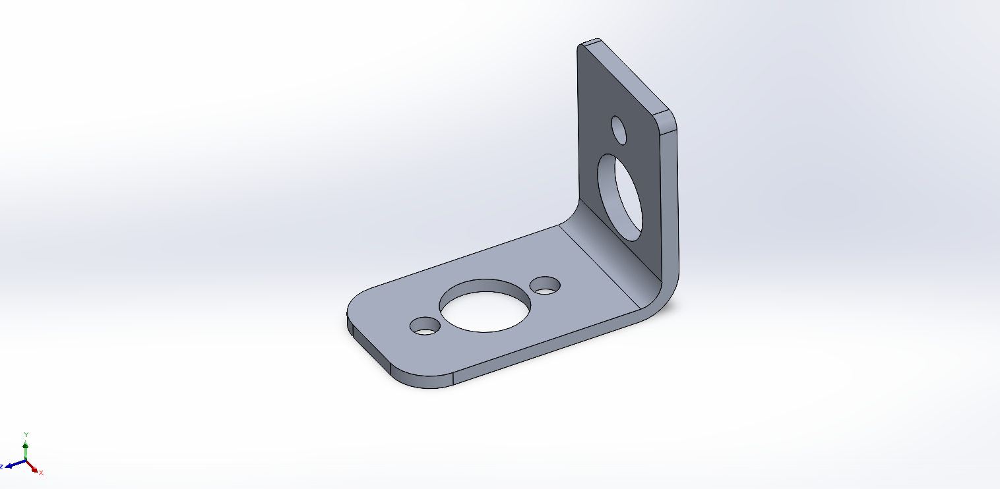
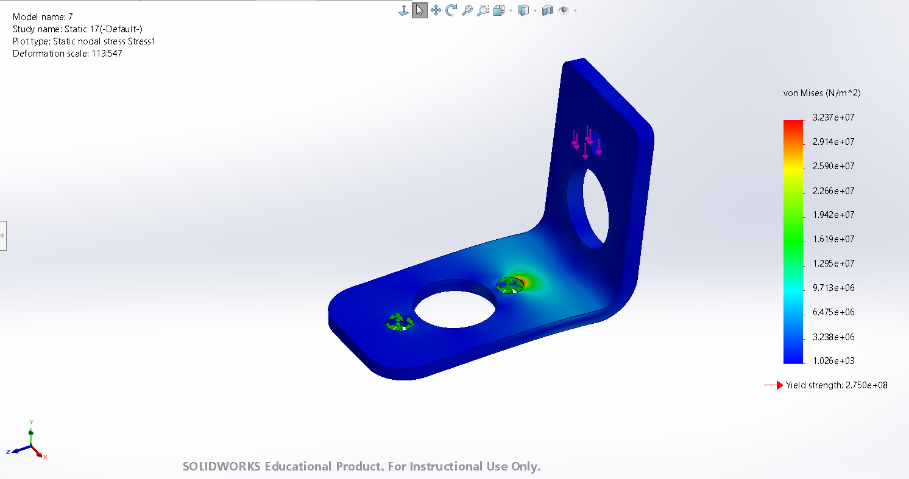
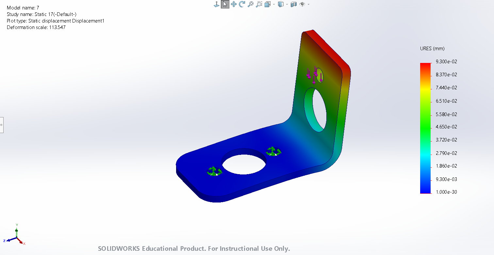
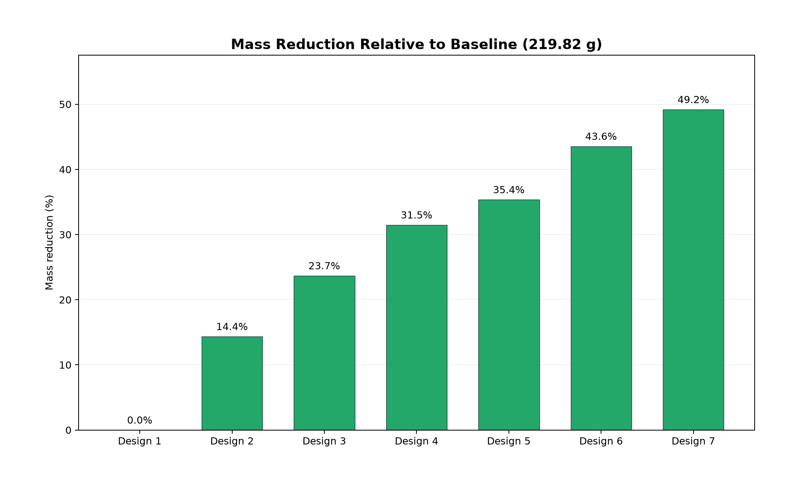
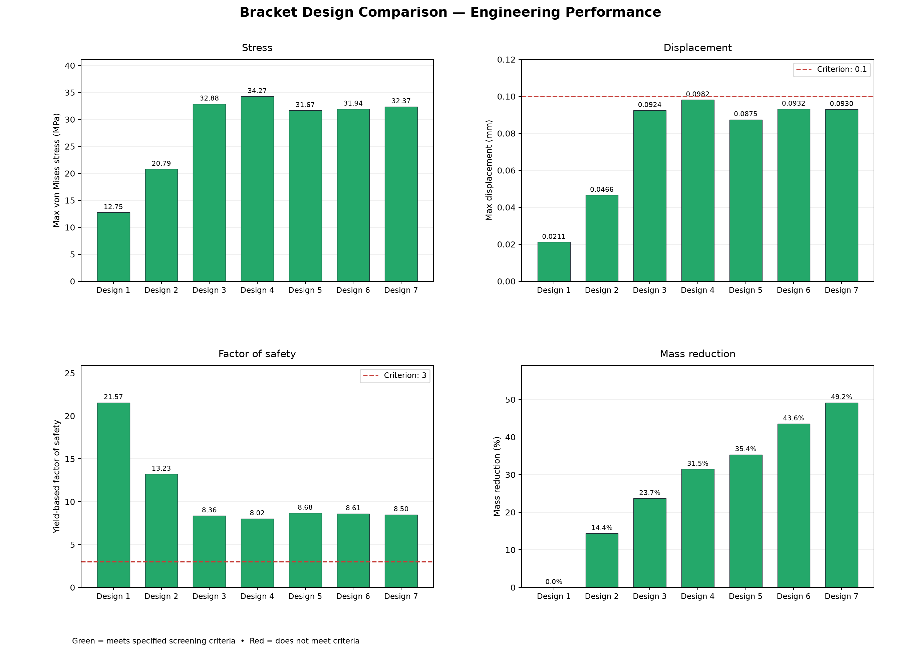
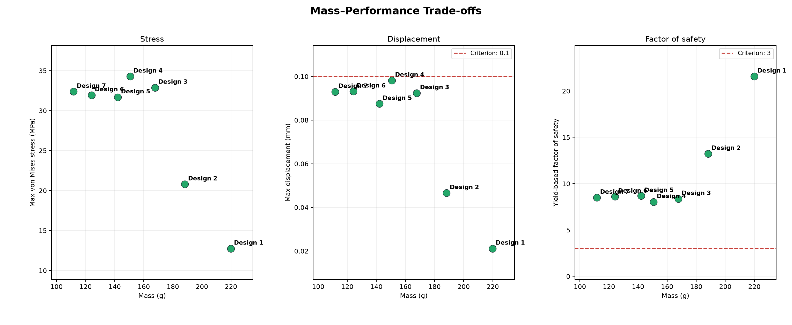
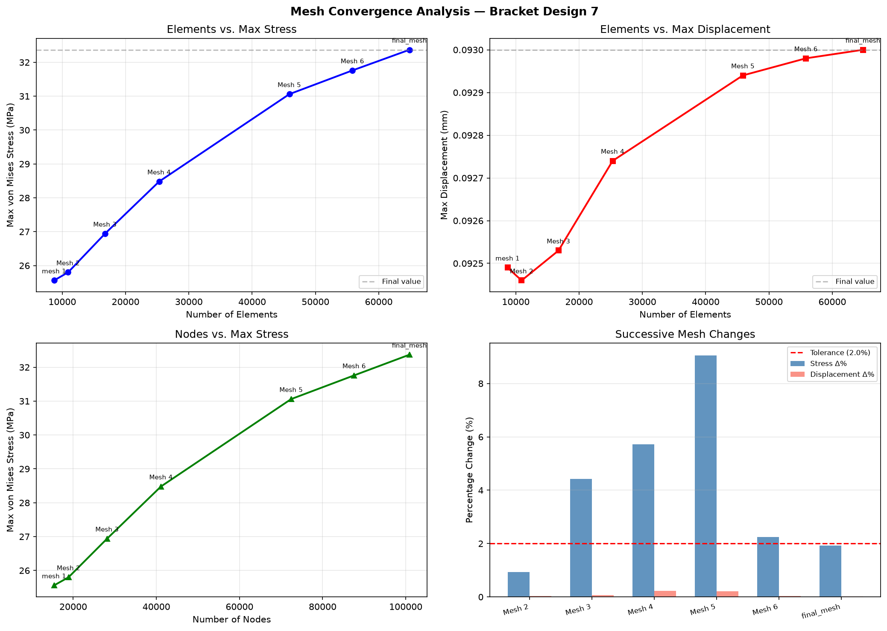
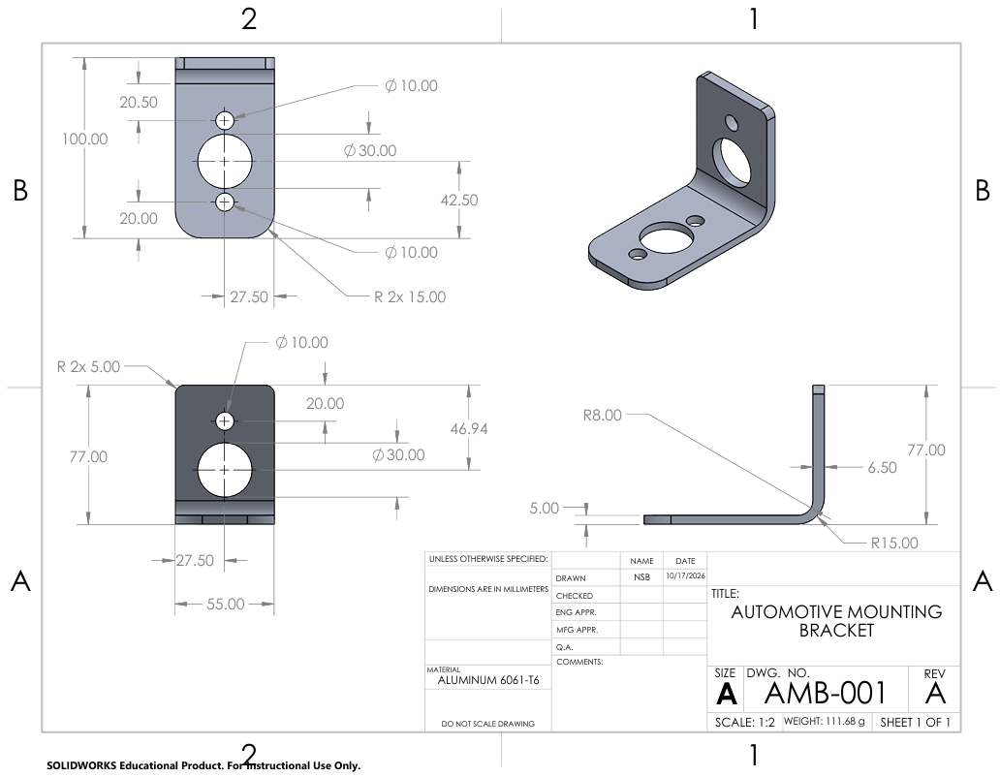

Lightweight Automotive Mounting Bracket Optimization

SolidWorks | Finite Element Analysis (FEA) | Python | Structural Optimization

An independent mechanical engineering project focused on designing, analyzing, and optimizing a lightweight automotive mounting bracket through iterative CAD modifications, finite element simulations, mesh refinement, and Python-based engineering analysis.
The project achieved a 49.19% mass reduction while meeting the selected structural strength and stiffness criteria under an assumed 100 N static load.

Project Highlights
Performance Metric	Baseline Design	Final Design
Mass	219.82 g	111.68 g
Maximum von Mises Stress	12.75 MPa	32.37 MPa
Maximum Displacement	0.02114 mm	0.09300 mm
Yield-Based Factor of Safety	21.57	8.50
Key result: Reduced mass by 108.14 g (49.19%), while maintaining a yield-based factor of safety above 3 and maximum displacement below 0.10 mm for the analyzed load case.
1. Project Objectives
Design an automotive mounting bracket using SolidWorks.
Perform static structural analysis in SolidWorks Simulation.
Reduce mass through iterative geometry optimization.
Evaluate stress, displacement, and yield-based factor of safety.
Assess mesh sensitivity using a mesh-refinement study.
Compare material alternatives.
Develop a Python tool for engineering calculations, design comparisons, graphs, and reports.
2. CAD Design and FEA Setup
The bracket was modeled using Aluminum 6061-T6, with a modeled yield strength of 275 MPa.
Parameter	Value
Material	Aluminum 6061-T6
Applied force	100 N downward
Fixtures	Fixed inner surfaces of two lower mounting holes
Minimum factor of safety	3.0
Maximum displacement criterion	0.10 mm
Analysis type	Linear static FEA
The 100 N load and structural limits were selected for this engineering design study, rather than taken from a specific vehicle manufacturer's requirements.
Final CAD Model

Von Mises Stress Distribution

Final maximum von Mises stress: 32.37 MPa.
Displacement Distribution

Final maximum resultant displacement: 0.09300 mm.
3. Design Optimization
Seven design iterations were evaluated using geometric changes including plate-thickness adjustments, width reduction, and cutouts. The goal was to minimize mass while meeting the selected strength and stiffness criteria.
Mass Reduction Across Designs

The mass decreased from 219.82 g to 111.68 g, representing a 49.19% reduction.
Design Performance Comparison

Mass–Performance Trade-Offs

The Python plots compare mass, stress, displacement, and factor of safety across the recorded design iterations.
4. Mesh-Refinement Analysis
A mesh-refinement study was performed on Design 7 to assess the sensitivity of the calculated stress and displacement to mesh density.
Final Mesh Metric	Value
Elements	64,851
Nodes	100,892
Maximum von Mises stress	32.37 MPa
Maximum displacement	0.09300 mm
Mesh-Refinement Results

Between the final two mesh levels, the maximum stress changed by approximately 1.92%, and the maximum displacement changed by approximately 0.0215%. Both changes were below the selected 2% comparison tolerance.
5. Python Engineering Analysis Tool
I developed a Python program to organize SolidWorks FEA results and support the engineering optimization workflow. Its capabilities include:
Saving and managing bracket designs and simulation records.
Calculating yield-based factors of safety.
Comparing mass, stress, displacement, and design trade-offs.
Identifying designs that meet selected performance constraints.
Analyzing mesh-refinement data.
Generating engineering graphs and reports.
Estimating results under different loads using simplified linear-elastic scaling assumptions.
SolidWorks provides the FEA results; Python processes, compares, and presents those results.
Tools and Technologies
SolidWorks: 3D CAD modeling and engineering drawings
SolidWorks Simulation: Static FEA and mesh refinement
Python: Engineering analysis and report generation
NumPy: Numerical calculations
Matplotlib: Data visualization
JSON: Design and simulation data storage
Running the Python Program
Install the dependencies:
```bash
pip install -r requirements.txt
```
Run the program:
```bash
python main.py
```
**Note:** The program's expected local data-folder structure must match the paths used in `main.py` when running it from a downloaded copy of this repository.

## 6. Engineering Drawing



The drawing includes principal dimensions, mounting-hole locations, material, and the final design designation AMB-001.

[View Engineering Drawing — AMB-001 (PDF)](documentation/AMB-001_Drawing.pdf)

## 7. Full Engineering Report

The technical report documents the design methodology, FEA setup, seven design iterations, mesh-refinement results, material comparison, engineering calculations, final SolidWorks results, and study limitations.

[View Full Engineering Report (PDF)](documentation/Engineering_Report.pdf)

## 8. Study Limitations

The analysis represents a simplified linear-static loading case with idealized fixed supports. It does not include fatigue, vibration, impact, bolt preload, detailed contact behavior, or physical prototype testing. Additional analysis and validation would be needed before using the design in a real automotive assembly.

## 9. Conclusion

The final bracket achieved a **49.19% mass reduction**, with a recorded maximum von Mises stress of **32.37 MPa**, maximum displacement of **0.09300 mm**, and yield-based factor of safety of **8.50** under the assumed 100 N static load.

The project demonstrates an integrated workflow involving CAD design, structural simulation, mesh refinement, Python-based engineering analysis, and technical documentation.

---

Project Type: Independent Mechanical Engineering Project
Tools: SolidWorks, SolidWorks Simulation, Python
Author: Nathinael Solomon Befekadu
St. Mary's University — Mechanical Engineering
